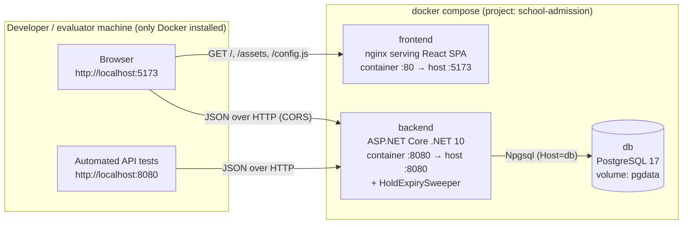
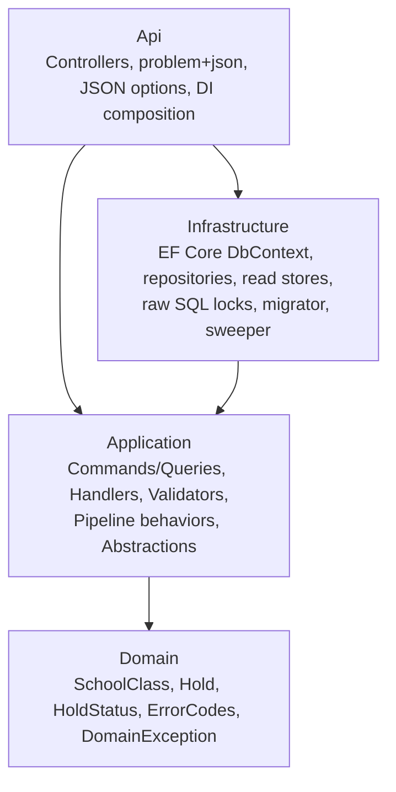
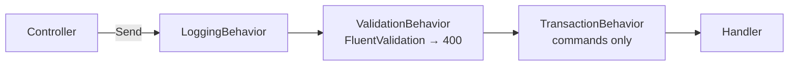
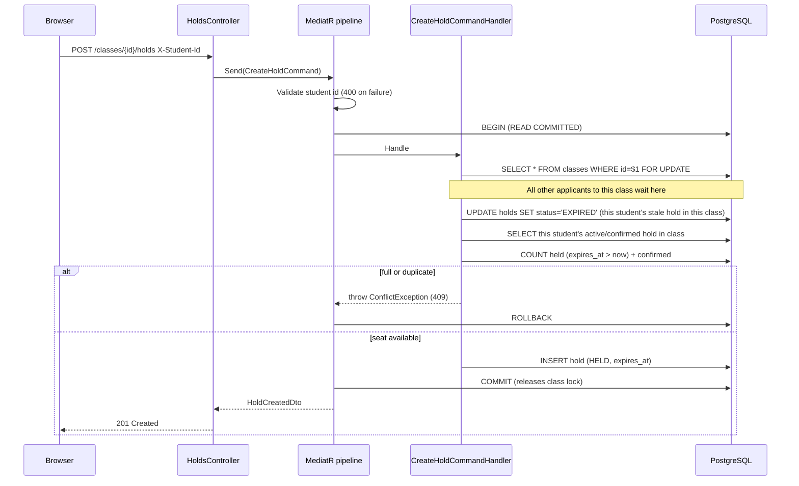
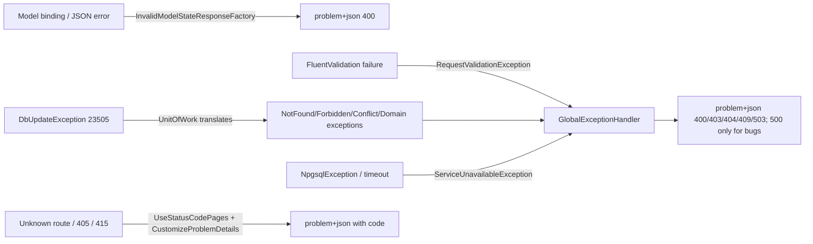

# Architecture.md

## 1. System context



Key point: the **browser** calls the backend directly at `http://localhost:8080`. nginx only serves static files. Container-to-container traffic (backend → db) uses compose service names.

---

## 2. Repository layout

```
/
├── README.md                     # D3 (run, URL, tests)
├── ASSUMPTIONS.md                # D4 (copy of docs/ASSUMPTIONS.md)
├── AI_USAGE.md                   # D6
├── AGENTS.md                     # optional copy of docs/Agents.md
├── docker-compose.yml            # db + backend + frontend (+ test profile)
├── docker-compose.dev.yml        # exposes db on localhost:5433 for local dev
├── docker-compose.multi.yml      # adds backend-2 on :8081 (bonus B1)
├── .env.example  .gitignore  .gitattributes
├── scripts/concurrency-smoke.sh
├── docs/
├── backend/
│   ├── SchoolAdmission.sln
│   ├── Dockerfile  .dockerignore  Directory.Build.props
│   ├── src/
│   │   ├── SchoolAdmission.Domain/
│   │   │   ├── Entities/            SchoolClass.cs, Hold.cs
│   │   │   ├── Enums/               HoldStatus.cs
│   │   │   ├── Errors/              ErrorCodes.cs, DomainException.cs
│   │   │   └── StudentIdentifier.cs
│   │   ├── SchoolAdmission.Application/
│   │   │   ├── Abstractions/
│   │   │   │   ├── Messaging/       ICommand.cs, IQuery.cs
│   │   │   │   ├── Persistence/     IClassRepository.cs, IHoldRepository.cs, IUnitOfWork.cs
│   │   │   │   └── ReadModels/      IClassReadStore.cs, IHoldReadStore.cs
│   │   │   ├── Behaviors/           LoggingBehavior.cs, ValidationBehavior.cs, TransactionBehavior.cs
│   │   │   ├── Common/
│   │   │   │   ├── Exceptions/      AppException.cs, NotFoundException.cs, ForbiddenException.cs,
│   │   │   │   │                    ConflictException.cs, RequestValidationException.cs, ServiceUnavailableException.cs
│   │   │   │   ├── Options/         HoldOptions.cs
│   │   │   │   ├── Time/            TimeExtensions.cs (TruncateToSeconds)
│   │   │   │   └── Validation/      StudentIdRules.cs (FluentValidation extension)
│   │   │   ├── Classes/
│   │   │   │   ├── CreateClass/     Command, Validator, Handler, CreatedClassDto
│   │   │   │   ├── GetClasses/      Query, Handler
│   │   │   │   ├── GetClassById/    Query, Handler
│   │   │   │   └── ClassSeatSummaryDto.cs
│   │   │   ├── Holds/
│   │   │   │   ├── CreateHold/      Command, Validator, Handler, HoldCreatedDto
│   │   │   │   ├── GetHoldById/     Query, Handler, HoldDto
│   │   │   │   ├── ConfirmHold/     Command, Validator, Handler, HoldConfirmedDto
│   │   │   │   ├── CancelHold/      Command, Validator, Handler
│   │   │   │   ├── GetMyHolds/      Query, Validator, Handler, MyHoldDto
│   │   │   │   └── ExpireStaleHolds/ Command, Handler
│   │   │   └── DependencyInjection.cs
│   │   ├── SchoolAdmission.Infrastructure/
│   │   │   ├── Persistence/         AdmissionDbContext.cs, UnitOfWork.cs, DatabaseMigrator.cs,
│   │   │   │                        Configurations/, Converters/HoldStatusConverter.cs, Migrations/
│   │   │   ├── Repositories/        ClassRepository.cs, HoldRepository.cs
│   │   │   ├── ReadStores/          ClassReadStore.cs, HoldReadStore.cs
│   │   │   ├── BackgroundJobs/      HoldExpirySweeper.cs
│   │   │   └── DependencyInjection.cs
│   │   └── SchoolAdmission.Api/
│   │       ├── Controllers/         ClassesController.cs, HoldsController.cs, MeController.cs, HealthController.cs
│   │       ├── Contracts/           CreateClassRequest.cs
│   │       ├── ErrorHandling/       GlobalExceptionHandler.cs, ProblemDetailsSetup.cs
│   │       ├── Json/                UtcDateTimeOffsetConverter.cs
│   │       ├── Program.cs
│   │       └── appsettings.json
│   └── tests/
│       ├── SchoolAdmission.UnitTests/
│       └── SchoolAdmission.IntegrationTests/
│           ├── Infrastructure/      PostgresDatabase.cs, AdmissionApiFactory.cs, TestData.cs, ApiClientExtensions.cs
│           ├── Contract/  Classes/  Holds/  Concurrency/  Expiry/  Robustness/  Persistence/
└── frontend/
    ├── Dockerfile  nginx.conf  docker/40-runtime-config.sh
    ├── index.html  public/config.js
    ├── package.json  vite.config.ts  tsconfig.json
    └── src/
        ├── main.tsx  App.tsx  config.ts  styles.css
        ├── api/        client.ts, types.ts, classes.ts, holds.ts, serverClock.ts
        ├── hooks/      queries.ts, useCountdown.ts, useServerOffset.ts
        ├── student/    StudentContext.tsx, StudentIdBar.tsx, studentId.ts
        ├── pages/      ClassListPage.tsx, CreateClassPage.tsx, ApplicationPage.tsx, MyApplicationsPage.tsx
        ├── components/ Layout.tsx, ErrorBoundary.tsx, ErrorAlert.tsx, StatusBadge.tsx,
        │               ConnectionBanner.tsx, ConfirmDialog.tsx, Countdown.tsx
        ├── i18n/       messages.ts
        └── test/       setup.ts, server.ts, handlers.ts, fixtures.ts
```

---

## 3. Backend layers



| Layer | Owns | Must not |
|-------|------|----------|
| Domain | Entities, state transitions (`Hold.Confirm/Cancel/Expire`, `EffectiveStatus`), error codes | Reference any package |
| Application | Use cases (MediatR handlers), validation, transaction policy, DTOs (the JSON contract shapes), interfaces for persistence | Reference EF Core, Npgsql, ASP.NET |
| Infrastructure | EF Core, SQL, locks, migrations, background sweeper, translating DB errors to app exceptions | Contain business rules |
| Api | HTTP: routing, header/route parsing, status codes, problem+json, CORS, startup | Contain business rules |

---

## 4. CQRS with MediatR

- **Commands** (`ICommand<TResponse>`) change state. They run inside a DB transaction opened by `TransactionBehavior`. They use **repositories** (tracked entities, row locks).
- **Queries** (`IQuery<TResponse>`) never change state. No transaction. They use **read stores** (`AsNoTracking` projections straight to DTOs).

```csharp
public interface ICommandMarker;
public interface ICommand<out TResponse> : IRequest<TResponse>, ICommandMarker;
public interface IQuery<out TResponse> : IRequest<TResponse>;
```

### Pipeline (registered in this order)



`TransactionBehavior` begins a READ COMMITTED transaction, calls the handler, calls `SaveChangesAsync`, commits. Any exception → dispose without commit → rollback.

### Use-case catalog

| Endpoint | Request | Kind | Tx | Locks |
|----------|---------|------|----|-------|
| `POST /classes` | `CreateClassCommand(Name, TotalSeats)` | Command | ✔ | none (unique index) |
| `GET /classes` | `GetClassesQuery()` | Query | – | – |
| `GET /classes/{id}` | `GetClassByIdQuery(ClassId)` | Query | – | – |
| `POST /classes/{id}/holds` | `CreateHoldCommand(ClassId, StudentId)` | Command | ✔ | **class row `FOR UPDATE`** |
| `GET /holds/{id}` | `GetHoldByIdQuery(HoldId)` | Query | – | – |
| `POST /holds/{id}/confirm` | `ConfirmHoldCommand(HoldId, StudentId)` | Command | ✔ | hold row `FOR UPDATE` |
| `DELETE /holds/{id}` | `CancelHoldCommand(HoldId, StudentId)` | Command | ✔ | hold row `FOR UPDATE` |
| `GET /me/holds` | `GetMyHoldsQuery(StudentId)` | Query | – | – |
| (sweeper) | `ExpireStaleHoldsCommand(BatchSize)` | Command | ✔ | `FOR UPDATE SKIP LOCKED` batch |

Route IDs (`ClassId`, `HoldId`) travel as **raw strings**; handlers parse them with `RouteId.TryParse` so validation (400) always runs before not-found (404). See `Implementation.md §R8`.

---

## 5. Request flow example — apply



---

## 6. Concurrency design (R1, R3, R5, B1) — the heart of the system

### 6.1 Invariant
For every class `c`: `count(holds of c with status HELD and expires_at > now) + count(holds of c with status CONFIRMED) ≤ c.total_seats`.

### 6.2 Mechanism
1. **Counts are derived, never stored.** There is no `held_seats` column to drift. Expired seats stop counting the instant `expires_at` passes.
2. **The only operation that increases the sum is "create hold".** It runs in a transaction that first takes a **row lock on the class** (`SELECT ... FOR UPDATE`). All concurrent creates for the same class — from any backend process — queue on that lock in PostgreSQL. Inside the lock the handler counts and inserts; the lock is released at COMMIT, so the next waiter's count (a fresh READ COMMITTED snapshot per statement) sees the new row.
3. **Every other transition only decreases or preserves the sum**: confirm (HELD→CONFIRMED, sum unchanged), cancel (HELD→CANCELLED, −1), expire (HELD→EXPIRED, −1 or already not counted). They don't need the class lock; they lock the hold row.
4. **Rule R3** is enforced twice: (a) a check inside the class lock, (b) a **partial unique index** `ux_holds_class_student_active ON holds(class_id, student_id) WHERE status IN ('HELD','CONFIRMED')` as a database-level backstop. Because a stale stored-HELD row would block re-applying, the create handler first materializes *that student's own* stale hold in that class to EXPIRED (≤ 1 row thanks to the same index).
5. **Rule R5**: confirm locks the hold row; a second confirm waits, then sees CONFIRMED and returns 200 without changes. Counts are derived from rows, so a hold can only ever be counted once.

### 6.3 Why it's correct (sketch)
- Two creates for the same class cannot interleave between "count" and "insert" because both hold the same row lock.
- Confirm/cancel/expire racing with a create can only lower the count the create observes after it reads — never raise it — so the create can at worst be conservative, never oversell.
- The confirm-vs-expiry race is decided under the hold row lock: whoever locks first wins; the loser re-reads the committed status (READ COMMITTED re-check) and acts accordingly.

### 6.4 Deadlock analysis
- Create: locks 1 class row, then at most 1 hold row (own stale hold), then inserts.
- Confirm / cancel: lock 1 hold row.
- Sweeper: `FOR UPDATE SKIP LOCKED` — never waits on a locked row, so it can't participate in a cycle, even with two sweepers in two processes.
- No transaction acquires a class lock after a hold lock → no lock-order cycle.

### 6.5 Rejected alternatives
| Alternative | Why not |
|-------------|---------|
| C# `lock` / `SemaphoreSlim` | Breaks with 2 processes (B1); lost on restart |
| Stored counters + conditional `UPDATE ... WHERE held+confirmed < total` | Fast, but counters drift from reality on expiry unless the sweeper runs exactly on time; R2 says seats return automatically at expiry |
| SERIALIZABLE isolation | Correct but throws 40001 serialization failures under a burst → retries / 503s |
| Optimistic concurrency (`xmin` row version) | Under thousands of simultaneous applies almost every attempt conflicts → retry storms |
| Redis / queue | Extra infrastructure for no gain at this scale |

Cost: applies to *the same class* are serialized. Each critical section is ~3 short indexed queries + 1 insert (~1–3 ms), i.e. hundreds of applies per second per class — far beyond the need, and different classes proceed in parallel.

---

## 7. Expiry design (R2)

- `expires_at = truncate_to_seconds(now) + HOLD_DURATION_SECONDS`.
- **Logical expiry (authoritative):** every query treats `status='HELD' AND expires_at <= now` as EXPIRED; seat counts only count `expires_at > now`. So the seat is free the instant time passes, even if no background code runs.
- **Physical expiry (housekeeping):** `HoldExpirySweeper` (`BackgroundService`, every `HOLD_SWEEP_INTERVAL_SECONDS`, default 5) sends `ExpireStaleHoldsCommand`, which updates up to 500 rows per tick with `FOR UPDATE SKIP LOCKED`. Safe to run in N processes. Errors are logged and never crash the host. Disabled in tests via `HOLD_SWEEPER_ENABLED=false`.

---

## 8. Multi-instance (bonus B1)

All coordination lives in PostgreSQL: the class row lock, the partial unique index, `SKIP LOCKED` sweeping, and a `pg_advisory_lock` around startup migrations. The backend is stateless — no in-memory locks, caches or counters — so any number of instances on any ports can share one database. Demonstrated by `docker-compose.multi.yml` (`backend-2` on :8081), `scripts/concurrency-smoke.sh`, and the `TwoInstances_ShareDatabase_NeverOversell` integration test (two `WebApplicationFactory` hosts = two independent connection pools and DI containers).

Connection budget: each instance pools ≤ 100 connections; Postgres runs with `max_connections=300`.

---

## 9. Time

- `TimeProvider` is registered as a singleton (`TimeProvider.System`); tests replace it with `FakeTimeProvider`.
- All timestamps are UTC `DateTimeOffset` (offset 0), stored as `timestamptz`, serialized as `yyyy-MM-ddTHH:mm:ssZ`.
- Hold responses include `serverTime` so the UI can correct for client clock skew.
- Across instances, clocks are assumed NTP-synced (same host in compose). Skew could only shift the exact expiry moment; it cannot break R1 because the class lock serializes creates.

---

## 10. Error handling



Every problem body gets `code` and `traceId`. Stack traces are never returned.

---

## 11. Frontend architecture

| Concern | Approach |
|---------|----------|
| Routing | React Router: `/` Class List, `/admin/classes/new` Create Class, `/applications/:holdId` Application, `/my-applications` My Applications. nginx falls back to `index.html` so deep links survive refresh. |
| Server state | TanStack Query. Polling: classes every 3 s, an open hold every 5 s, my holds every 5 s. Mutations invalidate affected keys. |
| Identity | `StudentContext` holds the normalized 17-digit ID, persisted to `localStorage` (`sas.studentId`). Bengali digits (০–৯) are converted to ASCII. |
| Expiry UX | `useCountdown(expiresAt)` ticks every 250 ms using the server offset; at 0 the UI immediately shows `EXPIRED` and disables Pay, then refetches. |
| Errors | `ApiError` (kind: `http` / `network` / `timeout`, `code`, `status`) → `messages.ts` → `ErrorAlert`. `ConnectionBanner` when polling fails. `ErrorBoundary` around routes. |
| Config | `window.__APP_CONFIG__.API_BASE_URL` (from `/config.js`, written at container start) → `VITE_API_BASE_URL` → `http://localhost:8080`. |

---

## 12. Deployment (compose)

| Service | Image / build | Ports | Notes |
|---------|---------------|-------|-------|
| `db` | `postgres:17-alpine` | not published (dev override: 5433) | `max_connections=300`, healthcheck `pg_isready`, volume `pgdata` |
| `backend` | `./backend` (runtime stage) | 8080:8080 | `depends_on: db (healthy)`, migrates on start |
| `frontend` | `./frontend` (nginx stage) | 5173:80 | `API_BASE_URL` env → `/config.js` |
| `backend-tests` | `./backend` target `test` | – | profile `test` |
| `frontend-tests` | `./frontend` target `test` | – | profile `test` |
| `backend-2` | multi override | 8081:8080 | bonus |

---

## 13. Decision log (ADR summary)

| # | Decision | Reason |
|---|----------|--------|
| 1 | Clean Architecture + MediatR CQRS | Requested by the developer; clear separation of read/write paths |
| 2 | Derived counts + class row lock | Exact, drift-free, multi-instance safe, simple to prove |
| 3 | Exceptions → problem+json (not Result<T>) | Less ceremony, single mapping point |
| 4 | Repositories for commands, read stores for queries | Keeps EF out of Application; queries project straight to DTOs |
| 5 | UUID v7 IDs | Unguessable enough for public hold URLs, index-friendly |
| 6 | .NET 10 | .NET 8 support ends 10 Nov 2026 |
| 7 | Runtime `/config.js` | Backend URL configurable via env var without rebuilding |
| 8 | Polling (not SignalR/SSE) | Brief asks for "every few seconds"; simplest robust option |
