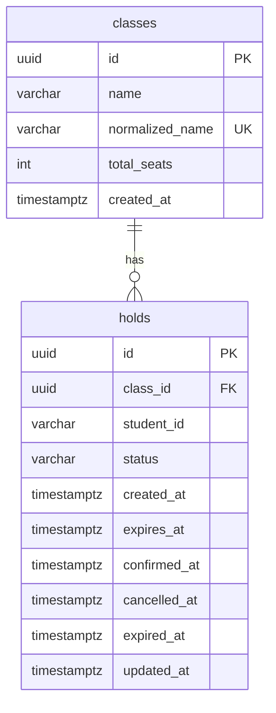

# Database.md

PostgreSQL 17. Two tables. Naming: `snake_case` tables/columns, set explicitly in EF configurations (no naming-convention package). All timestamps `timestamptz` in UTC.

---

## 1. Entity-relationship



---

## 2. Target schema (what the EF migration must produce)

```sql
CREATE TABLE classes (
    id               uuid          PRIMARY KEY,
    name             varchar(100)  NOT NULL,
    normalized_name  varchar(100)  NOT NULL,          -- UPPER(TRIM(name))
    total_seats      integer       NOT NULL,
    created_at       timestamptz   NOT NULL,
    CONSTRAINT ck_classes_total_seats CHECK (total_seats BETWEEN 1 AND 10000)
);
CREATE UNIQUE INDEX ux_classes_normalized_name ON classes (normalized_name);

CREATE TABLE holds (
    id            uuid          PRIMARY KEY,
    class_id      uuid          NOT NULL REFERENCES classes (id) ON DELETE RESTRICT,
    student_id    varchar(17)   NOT NULL,
    status        varchar(16)   NOT NULL,
    created_at    timestamptz   NOT NULL,
    expires_at    timestamptz   NOT NULL,
    confirmed_at  timestamptz   NULL,
    cancelled_at  timestamptz   NULL,
    expired_at    timestamptz   NULL,
    updated_at    timestamptz   NOT NULL,
    CONSTRAINT ck_holds_status        CHECK (status IN ('HELD','CONFIRMED','EXPIRED','CANCELLED')),
    CONSTRAINT ck_holds_student_id    CHECK (student_id ~ '^[0-9]{17}$'),
    CONSTRAINT ck_holds_expiry_order  CHECK (expires_at > created_at)
);

-- R3 backstop: at most one HELD-or-CONFIRMED hold per (class, student)
CREATE UNIQUE INDEX ux_holds_class_student_active
    ON holds (class_id, student_id) WHERE status IN ('HELD','CONFIRMED');

-- Seat counting per class
CREATE INDEX ix_holds_class_status_expires ON holds (class_id, status, expires_at);

-- GET /me/holds
CREATE INDEX ix_holds_student_created ON holds (student_id, created_at DESC);

-- Sweeper
CREATE INDEX ix_holds_held_expires ON holds (expires_at) WHERE status = 'HELD';
```

Notes:
- No seat counter columns. Counts are always derived (see `Architecture.md §6`).
- Rows are never deleted. Cancel/expire change `status`.
- `normalized_name` gives case-insensitive uniqueness without an expression index.

---

## 3. Domain ↔ column mapping

### `SchoolClass` → `classes`
| Property | Column | Type |
|----------|--------|------|
| `Guid Id` | `id` | uuid, `ValueGeneratedNever()` (app generates UUID v7) |
| `string Name` | `name` | varchar(100) |
| `string NormalizedName` | `normalized_name` | varchar(100) |
| `int TotalSeats` | `total_seats` | integer |
| `DateTimeOffset CreatedAt` | `created_at` | timestamptz |

### `Hold` → `holds`
| Property | Column | Type |
|----------|--------|------|
| `Guid Id` | `id` | uuid |
| `Guid ClassId` | `class_id` | uuid FK |
| `string StudentId` | `student_id` | varchar(17) |
| `HoldStatus Status` | `status` | varchar(16) via `HoldStatusConverter` (`Held` ↔ `"HELD"`) |
| `DateTimeOffset CreatedAt/ExpiresAt/UpdatedAt` | `created_at/expires_at/updated_at` | timestamptz |
| `DateTimeOffset? ConfirmedAt/CancelledAt/ExpiredAt` | `confirmed_at/cancelled_at/expired_at` | timestamptz null |

---

## 4. EF Core configuration (reference)

```csharp
internal sealed class HoldStatusConverter() : ValueConverter<HoldStatus, string>(
    v => v.ToString().ToUpperInvariant(),
    v => Enum.Parse<HoldStatus>(v, true))
{
    public static readonly HoldStatusConverter Instance = new();
}

internal sealed class SchoolClassConfiguration : IEntityTypeConfiguration<SchoolClass>
{
    public void Configure(EntityTypeBuilder<SchoolClass> b)
    {
        b.ToTable("classes", t => t.HasCheckConstraint("ck_classes_total_seats", "total_seats BETWEEN 1 AND 10000"));
        b.HasKey(c => c.Id);
        b.Property(c => c.Id).HasColumnName("id").ValueGeneratedNever();
        b.Property(c => c.Name).HasColumnName("name").HasMaxLength(100).IsRequired();
        b.Property(c => c.NormalizedName).HasColumnName("normalized_name").HasMaxLength(100).IsRequired();
        b.Property(c => c.TotalSeats).HasColumnName("total_seats");
        b.Property(c => c.CreatedAt).HasColumnName("created_at");
        b.HasIndex(c => c.NormalizedName).IsUnique().HasDatabaseName("ux_classes_normalized_name");
    }
}

internal sealed class HoldConfiguration : IEntityTypeConfiguration<Hold>
{
    public void Configure(EntityTypeBuilder<Hold> b)
    {
        b.ToTable("holds", t =>
        {
            t.HasCheckConstraint("ck_holds_status", "status IN ('HELD','CONFIRMED','EXPIRED','CANCELLED')");
            t.HasCheckConstraint("ck_holds_student_id", "student_id ~ '^[0-9]{17}$'");
            t.HasCheckConstraint("ck_holds_expiry_order", "expires_at > created_at");
        });
        b.HasKey(h => h.Id);
        b.Property(h => h.Id).HasColumnName("id").ValueGeneratedNever();
        b.Property(h => h.ClassId).HasColumnName("class_id");
        b.Property(h => h.StudentId).HasColumnName("student_id").HasMaxLength(17).IsRequired();
        b.Property(h => h.Status).HasColumnName("status").HasMaxLength(16).HasConversion(HoldStatusConverter.Instance);
        b.Property(h => h.CreatedAt).HasColumnName("created_at");
        b.Property(h => h.ExpiresAt).HasColumnName("expires_at");
        b.Property(h => h.ConfirmedAt).HasColumnName("confirmed_at");
        b.Property(h => h.CancelledAt).HasColumnName("cancelled_at");
        b.Property(h => h.ExpiredAt).HasColumnName("expired_at");
        b.Property(h => h.UpdatedAt).HasColumnName("updated_at");

        b.HasOne<SchoolClass>().WithMany().HasForeignKey(h => h.ClassId).OnDelete(DeleteBehavior.Restrict);

        b.HasIndex(h => new { h.ClassId, h.StudentId }).IsUnique()
            .HasFilter("status IN ('HELD','CONFIRMED')")
            .HasDatabaseName("ux_holds_class_student_active");
        b.HasIndex(h => new { h.ClassId, h.Status, h.ExpiresAt }).HasDatabaseName("ix_holds_class_status_expires");
        b.HasIndex(h => new { h.StudentId, h.CreatedAt }).IsDescending(false, true).HasDatabaseName("ix_holds_student_created");
        b.HasIndex(h => h.ExpiresAt).HasFilter("status = 'HELD'").HasDatabaseName("ix_holds_held_expires");
    }
}
```

DbContext:
```csharp
public sealed class AdmissionDbContext(DbContextOptions<AdmissionDbContext> options) : DbContext(options)
{
    public DbSet<SchoolClass> Classes => Set<SchoolClass>();
    public DbSet<Hold> Holds => Set<Hold>();
    protected override void OnModelCreating(ModelBuilder mb) =>
        mb.ApplyConfigurationsFromAssembly(typeof(AdmissionDbContext).Assembly);
}
```

Registration:
```csharp
services.AddDbContext<AdmissionDbContext>(o =>
    o.UseNpgsql(configuration.GetConnectionString("Default")
        ?? throw new InvalidOperationException("ConnectionStrings__Default is not set.")));
// Do NOT call EnableRetryOnFailure().
```

---

## 5. Key queries (implemented in Infrastructure)

### 5.1 Lock the class (create hold)
```csharp
var rows = await db.Classes
    .FromSqlInterpolated($"SELECT * FROM classes WHERE id = {classId} FOR UPDATE")
    .ToListAsync(ct);          // no LINQ operators → EF sends the SQL as-is
return rows.SingleOrDefault();
```

### 5.2 Materialize this student's own stale hold (create hold)
```csharp
await db.Holds
    .Where(h => h.ClassId == classId && h.StudentId == studentId
             && h.Status == HoldStatus.Held && h.ExpiresAt <= now)
    .ExecuteUpdateAsync(s => s
        .SetProperty(h => h.Status, HoldStatus.Expired)
        .SetProperty(h => h.ExpiredAt, now)
        .SetProperty(h => h.UpdatedAt, now), ct);
```

### 5.3 Seat counts for one class
```csharp
var held = await db.Holds.CountAsync(h => h.ClassId == classId
    && h.Status == HoldStatus.Held && h.ExpiresAt > now, ct);
var confirmed = await db.Holds.CountAsync(h => h.ClassId == classId
    && h.Status == HoldStatus.Confirmed, ct);
```

### 5.4 Class list with counts (read store)
```csharp
var rows = await db.Classes.AsNoTracking()
    .OrderBy(c => c.CreatedAt).ThenBy(c => c.Id)
    .Select(c => new
    {
        c.Id, c.Name, c.TotalSeats,
        Held = db.Holds.Count(h => h.ClassId == c.Id && h.Status == HoldStatus.Held && h.ExpiresAt > now),
        Confirmed = db.Holds.Count(h => h.ClassId == c.Id && h.Status == HoldStatus.Confirmed)
    })
    .ToListAsync(ct);
// map → ClassSeatSummaryDto(Id, Name, TotalSeats, Held, Confirmed, Math.Max(0, TotalSeats - Held - Confirmed))
```

### 5.5 Lock one hold (confirm / cancel)
```csharp
var rows = await db.Holds
    .FromSqlInterpolated($"SELECT * FROM holds WHERE id = {holdId} FOR UPDATE")
    .ToListAsync(ct);
return rows.SingleOrDefault();   // tracked; modify then SaveChanges (TransactionBehavior)
```

### 5.6 Sweeper batch
```csharp
return await db.Database.ExecuteSqlInterpolatedAsync($"""
    UPDATE holds
       SET status = 'EXPIRED', expired_at = {now}, updated_at = {now}
     WHERE id IN (
           SELECT id FROM holds
            WHERE status = 'HELD' AND expires_at <= {now}
            ORDER BY expires_at
            LIMIT {batchSize}
            FOR UPDATE SKIP LOCKED)
    """, ct);
```

All raw SQL uses interpolation → parameters. **Never** concatenate strings into SQL.

---

## 6. Translating constraint violations

`UnitOfWork.SaveChangesAsync` catches `DbUpdateException` whose inner exception is `PostgresException { SqlState: PostgresErrorCodes.UniqueViolation }` and rethrows by `ConstraintName`:

| Constraint | Becomes |
|------------|---------|
| `ux_classes_normalized_name` | `ConflictException(CLASS_NAME_EXISTS)` |
| `ux_holds_class_student_active` | `ConflictException(ACTIVE_HOLD_EXISTS)` |

Check-constraint violations (`23514`) indicate a validation gap → log as error, return 400 `VALIDATION_FAILED` (and add the missing validator rule).

`NpgsqlException` (connection refused, pool exhausted, timeout) → `ServiceUnavailableException` → 503.

---

## 7. Migrations

- Location: `backend/src/SchoolAdmission.Infrastructure/Persistence/Migrations/`. **Commit them.**
- Create: `dotnet ef migrations add InitialCreate -p src/SchoolAdmission.Infrastructure -s src/SchoolAdmission.Api -o Persistence/Migrations` (needs `dotnet tool install --global dotnet-ef` and `Microsoft.EntityFrameworkCore.Design` in the Api project).
- Applied automatically at startup by `DatabaseMigrator`:
  1. Retry opening a connection up to 15 times, 2 s apart.
  2. `SELECT pg_advisory_lock(7272026)` on a dedicated connection (serializes migrations across instances).
  3. `await db.Database.MigrateAsync()`.
  4. `SELECT pg_advisory_unlock(7272026)` in `finally`.
- After any model change, add a migration — EF Core 9+ refuses to migrate when the model has pending changes.

---

## 8. Connection settings

`Host=db;Port=5432;Database=admission;Username=admission;Password=admission;Maximum Pool Size=100;Timeout=15;Command Timeout=30`

Postgres runs with `-c max_connections=300` so two instances (2 × 100) plus tooling fit.

---

## 9. Persistence (R6)

Data lives in the named volume `pgdata` mounted at `/var/lib/postgresql/data` (correct path for Postgres ≤ 17). `docker compose down` keeps it; `docker compose down -v` deletes it.

---

## 10. Inspection SQL

```sql
-- Invariant check: must return zero rows
SELECT c.id, c.name, c.total_seats,
       COUNT(*) FILTER (WHERE h.status='HELD' AND h.expires_at > now()) AS held,
       COUNT(*) FILTER (WHERE h.status='CONFIRMED')                      AS confirmed
FROM classes c LEFT JOIN holds h ON h.class_id = c.id
GROUP BY c.id
HAVING COUNT(*) FILTER (WHERE h.status='HELD' AND h.expires_at > now())
     + COUNT(*) FILTER (WHERE h.status='CONFIRMED') > c.total_seats;

-- R3 check: must return zero rows
SELECT class_id, student_id, COUNT(*) FROM holds
WHERE status = 'CONFIRMED' OR (status = 'HELD' AND expires_at > now())
GROUP BY class_id, student_id HAVING COUNT(*) > 1;

-- Stale rows awaiting the sweeper
SELECT COUNT(*) FROM holds WHERE status='HELD' AND expires_at <= now();
```
