# Feature_Development.md — How to Add or Change a Feature

## 1. Workflow

```mermaid
flowchart LR
    A[Find task in Implementation.md] --> B[Read PRD + API + relevant docs]
    B --> C[Write/extend failing test]
    C --> D[Domain change if needed]
    D --> E[Command/Query + Validator + Handler]
    E --> F[Repository / ReadStore]
    F --> G[Controller action]
    G --> H[Frontend: types → api fn → hook → UI → messages]
    H --> I[Run all tests + typecheck]
    I --> J[Update docs] --> K[Commit]
```



## 2. Where things go

| You need… | Put it in |
|-----------|-----------|
| A state rule (what transitions are legal) | `Domain/Entities/*.cs` method |
| A new error code | `Domain/Errors/ErrorCodes.cs` + `API.md §3` + `frontend/src/i18n/messages.ts` + `Design.md §5` |
| Input validation | `Application/<Feature>/<UseCase>/<UseCase>Validator.cs` |
| A write use case | `Application/<Feature>/<UseCase>/` as `ICommand<T>` |
| A read use case | `Application/<Feature>/<UseCase>/` as `IQuery<T>` |
| SQL / EF code | `Infrastructure/Repositories` (writes) or `Infrastructure/ReadStores` (reads) |
| HTTP mapping | `Api/Controllers` (thin) |
| JSON shape | DTO record in `Application/<Feature>/...Dto.cs`; property names = contract names |
| Config value | `HoldOptions` (or new options class) + env var + `Setup.md §4` + compose |

## 3. Naming

| Kind | Pattern | Example |
|------|---------|---------|
| Command | `<Verb><Noun>Command` | `ConfirmHoldCommand` |
| Query | `Get<Noun>[By<X>]Query` | `GetMyHoldsQuery` |
| Handler | `<Request>Handler` | `ConfirmHoldCommandHandler` |
| Validator | `<Request>Validator` | `ConfirmHoldCommandValidator` |
| DTO | `<Noun><Qualifier>Dto` | `HoldConfirmedDto` |
| Test | `<Subject>_<Condition>_<Expected>` | `Confirm_ByOtherStudent_Returns403` |
| React page | `<Name>Page.tsx` | `ApplicationPage.tsx` |
| React hook | `use<Name>` | `useHold` |

## 4. Templates

### 4.1 Command
```csharp
namespace SchoolAdmission.Application.Holds.CancelHold;

public sealed record CancelHoldCommand(string HoldId, string? StudentId) : ICommand<Unit>;

public sealed class CancelHoldCommandValidator : AbstractValidator<CancelHoldCommand>
{
    public CancelHoldCommandValidator() => RuleFor(x => x.StudentId).ValidStudentId();
}

public sealed class CancelHoldCommandHandler(IHoldRepository holds, TimeProvider clock)
    : IRequestHandler<CancelHoldCommand, Unit>
{
    public async Task<Unit> Handle(CancelHoldCommand cmd, CancellationToken ct)
    {
        if (!RouteId.TryParse(cmd.HoldId, out var holdId))
            throw new NotFoundException(ErrorCodes.HoldNotFound, "This application does not exist.");

        var now = clock.GetUtcNow().TruncateToSeconds();
        var hold = await holds.GetByIdForUpdateAsync(holdId, ct)
            ?? throw new NotFoundException(ErrorCodes.HoldNotFound, "This application does not exist.");
        if (hold.StudentId != cmd.StudentId!.Trim())
            throw new ForbiddenException(ErrorCodes.HoldNotOwned, "This application belongs to a different student.");

        hold.Cancel(now);          // idempotent; throws DomainException for illegal states
        return Unit.Value;         // TransactionBehavior saves + commits
    }
}
```

### 4.2 Query
```csharp
namespace SchoolAdmission.Application.Holds.GetMyHolds;

public sealed record GetMyHoldsQuery(string? StudentId) : IQuery<IReadOnlyList<MyHoldDto>>;

public sealed class GetMyHoldsQueryValidator : AbstractValidator<GetMyHoldsQuery>
{
    public GetMyHoldsQueryValidator() => RuleFor(x => x.StudentId).ValidStudentId();
}

public sealed class GetMyHoldsQueryHandler(IHoldReadStore store, TimeProvider clock)
    : IRequestHandler<GetMyHoldsQuery, IReadOnlyList<MyHoldDto>>
{
    public Task<IReadOnlyList<MyHoldDto>> Handle(GetMyHoldsQuery q, CancellationToken ct) =>
        store.GetByStudentAsync(q.StudentId!.Trim(), clock.GetUtcNow(), ct);
}

public sealed record MyHoldDto(
    Guid HoldId, Guid ClassId, string ClassName, string Status, DateTimeOffset ExpiresAt,
    DateTimeOffset CreatedAt);   // extras after contract fields
```

Read store computes **effective** status:
```csharp
static string Effective(HoldStatus s, DateTimeOffset expiresAt, DateTimeOffset now) =>
    (s == HoldStatus.Held && expiresAt <= now ? HoldStatus.Expired : s).ToString().ToUpperInvariant();
```

### 4.3 Controller action
```csharp
[ApiController]
[Route("me")]
public sealed class MeController(ISender sender) : ControllerBase
{
    [HttpGet("holds")]
    public async Task<IActionResult> MyHolds([FromHeader(Name = "X-Student-Id")] string? studentId, CancellationToken ct) =>
        Ok(await sender.Send(new GetMyHoldsQuery(studentId), ct));
}
```

### 4.4 Integration test
```csharp
[Fact]
public async Task Cancel_ByOtherStudent_Returns403()
{
    using var client = _factory.CreateClient();
    var classId = await client.CreateClassIdAsync("Cancel 403", 5);
    var holdId = await client.CreateHoldIdAsync(classId, TestData.StudentId(1));

    using var res = await client.CancelAsync(holdId, TestData.StudentId(2));

    Assert.Equal(HttpStatusCode.Forbidden, res.StatusCode);
    Assert.Equal("HOLD_NOT_OWNED", await res.ProblemCodeAsync());
}
```

### 4.5 Frontend: API function + hook + usage
```ts
// api/holds.ts
export const cancelHold = (holdId: string, studentId: string) =>
  apiFetch<void>(`/holds/${encodeURIComponent(holdId)}`, { method: 'DELETE', studentId });

// hooks/queries.ts
export function useCancelHold(holdId: string) {
  const qc = useQueryClient();
  const { studentId } = useStudent();
  return useMutation({
    mutationFn: () => cancelHold(holdId, studentId!),
    onSettled: () => {
      qc.invalidateQueries({ queryKey: ['hold', holdId] });
      qc.invalidateQueries({ queryKey: ['classes'] });
      qc.invalidateQueries({ queryKey: ['myHolds', studentId] });
    },
  });
}

// in a component
const cancel = useCancelHold(holdId);
{cancel.error && <ErrorAlert error={cancel.error} />}
<button disabled={cancel.isPending} onClick={() => cancel.mutate()}>Cancel application</button>
```

`ErrorAlert` turns any `unknown` error into text via `toUserMessage(error)` from `messages.ts`.

### 4.6 Frontend test
```tsx
it('shows a friendly message when seats are full', async () => {
  server.use(http.post('*/classes/:id/holds', () =>
    HttpResponse.json({ status: 409, code: 'NO_SEATS_AVAILABLE', title: 'No seats available' }, { status: 409 })));
  renderApp('/', { studentId: '20152691234567890' });
  await userEvent.click(await screen.findByRole('button', { name: 'Apply' }));
  expect(await screen.findByRole('alert')).toHaveTextContent(/all seats in this class are taken/i);
});
```

## 5. Adding an error code (checklist)

1. `ErrorCodes.cs` constant.
2. Throw it with a human `detail`.
3. HTTP status mapping in `GlobalExceptionHandler` if it's a new exception type.
4. `API.md §3` table + endpoint check order.
5. `messages.ts` mapping + `Design.md §5` copy.
6. Backend test asserting `code`; frontend test if user-visible.

## 6. "If you change X, update Y"

| Change | Also update |
|--------|-------------|
| Any endpoint/DTO | `API.md`, `src/api/types.ts`, contract tests, MSW handlers |
| Entity/column/index | migration, `Database.md` |
| Env var | compose files, `.env.example`, `Setup.md §4` |
| A spec interpretation | `ASSUMPTIONS.md` (root and docs copy) |
| Screen behavior or copy | `Design.md` |
| New package | `Agents.md §4` if it's a pinned decision; check its license |

## 7. Commits

> Full rules, branch model and the planned commit list: `Git_Workflow.md`. Summary below.

Conventional Commits: `type(scope): imperative summary` (≤ 72 chars).
Types: `feat`, `fix`, `test`, `refactor`, `docs`, `build`, `chore`, `perf`. Scopes: `backend`, `frontend`, `holds`, `classes`, `api`, `infra`, `domain`, `app`, `docker`.

Good:
```
feat(holds): lock class row when creating holds to prevent overselling
test(holds): add concurrent same-student apply test
fix(frontend): disable Pay button the instant the countdown ends
```
Bad: `update`, `wip`, `final`, `fix stuff`, one commit containing the whole project.

Each commit should build and pass tests. Commit at the end of each Implementation task (roughly 20–35 commits total).

## 8. Definition of Done

See `Agents.md §9`. In short: contract-exact, tested, no 500s, friendly UI errors, Docker still works, docs updated, commit proposed.
