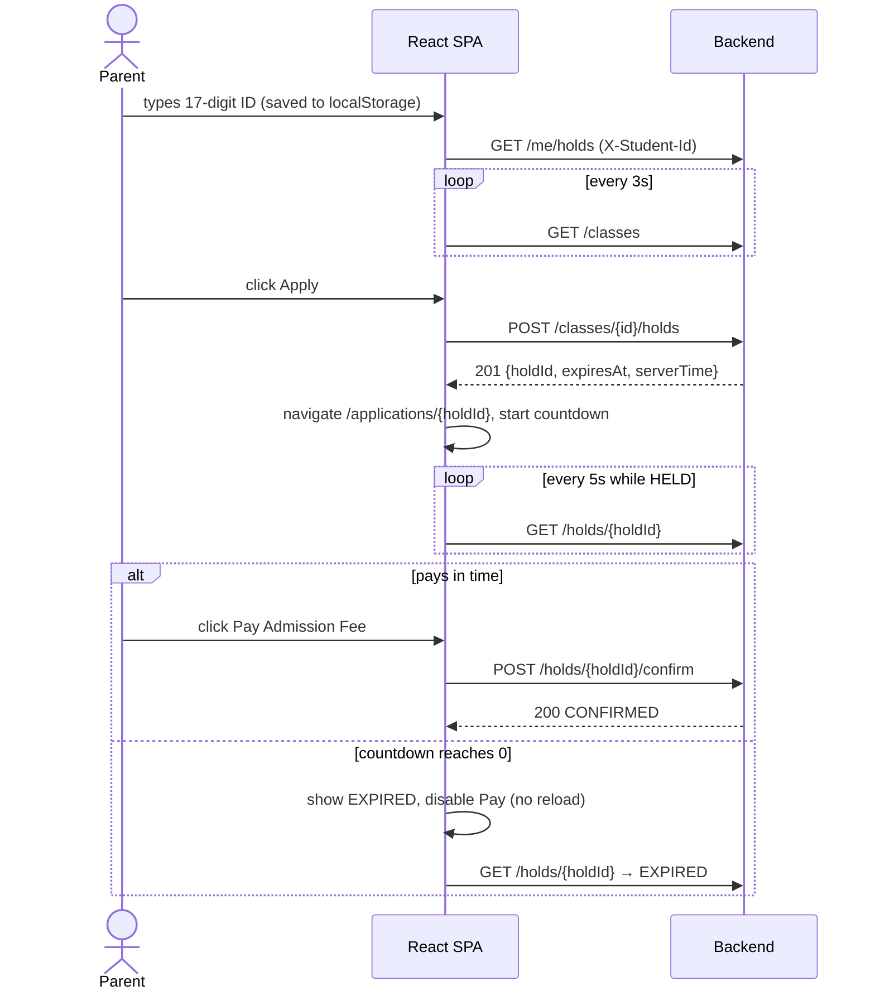

# Integration.md — Frontend ↔ Backend Wiring

## 1. Network topology (get this right first)

| Caller | Target | URL to use |
|--------|--------|------------|
| Browser (on host) | Backend | `http://localhost:8080` |
| Browser (on host) | Frontend | `http://localhost:5173` |
| Backend container | Postgres | `Host=db;Port=5432` |
| Test container | Postgres | `Host=db;Port=5432` |
| Locally-run backend / tests | Postgres (dev override) | `Host=localhost;Port=5433` |

The React app runs **in the browser**, not in the nginx container. So the frontend's API base URL is `http://localhost:8080`, **never** `http://backend:8080`.

---

## 2. Configuration chain (frontend)

`src/config.ts`:
```ts
declare global {
  interface Window { __APP_CONFIG__?: { API_BASE_URL?: string } }
}

const raw =
  window.__APP_CONFIG__?.API_BASE_URL ||          // runtime: written by container entrypoint
  import.meta.env.VITE_API_BASE_URL ||            // build/dev time
  'http://localhost:8080';                        // default

export const API_BASE_URL = raw.replace(/\/+$/, '');
```

`index.html` (before the module script):
```html
<script src="/config.js"></script>
<script type="module" src="/src/main.tsx"></script>
```

`public/config.js` (dev placeholder, overwritten in the container):
```js
window.__APP_CONFIG__ = {};
```

---

## 3. Runtime injection in Docker

`frontend/docker/40-runtime-config.sh` (the official nginx image runs every script in `/docker-entrypoint.d/` at start; file must have **LF** line endings):
```sh
#!/bin/sh
set -eu
API_BASE_URL="${API_BASE_URL:-http://localhost:8080}"
cat > /usr/share/nginx/html/config.js <<EOF
window.__APP_CONFIG__ = { API_BASE_URL: "${API_BASE_URL}" };
EOF
echo "runtime-config: API_BASE_URL=${API_BASE_URL}"
```

`frontend/nginx.conf`:
```nginx
server {
    listen 80;
    server_name _;
    root /usr/share/nginx/html;
    index index.html;

    # add_header in a location replaces server-level headers, so include them per location
    location = /config.js {
        add_header Cache-Control "no-store" always;
        add_header X-Content-Type-Options "nosniff" always;
    }
    location /assets/ {
        add_header Cache-Control "public, max-age=31536000, immutable" always;
        add_header X-Content-Type-Options "nosniff" always;
    }
    location / {
        try_files $uri $uri/ /index.html;          # SPA deep links survive refresh (R11)
        add_header Cache-Control "no-cache" always;
        add_header X-Content-Type-Options "nosniff" always;
        add_header Referrer-Policy "no-referrer" always;
        add_header X-Frame-Options "DENY" always;
    }
}
```

`frontend/Dockerfile`:
```dockerfile
FROM node:22-alpine AS deps
WORKDIR /app
COPY package.json package-lock.json ./
RUN npm ci

FROM deps AS build
COPY . .
RUN npm run build

FROM deps AS test
COPY . .
CMD ["npm", "run", "test", "--", "--run"]

FROM nginx:1.28-alpine AS runtime
COPY nginx.conf /etc/nginx/conf.d/default.conf
COPY docker/40-runtime-config.sh /docker-entrypoint.d/40-runtime-config.sh
RUN chmod +x /docker-entrypoint.d/40-runtime-config.sh
COPY --from=build /app/dist /usr/share/nginx/html
EXPOSE 80
```

---

## 4. CORS (backend)

The browser sends `X-Student-Id` (a custom header) and `Content-Type: application/json`, which triggers a **preflight `OPTIONS`**. The backend policy (see `Implementation.md §R1`):

- Origins from `CORS_ALLOWED_ORIGINS` (default `http://localhost:5173,http://127.0.0.1:5173`).
- Headers `Content-Type`, `X-Student-Id`. Methods `GET`, `POST`, `DELETE`. Exposed header `Location`.
- `app.UseCors("frontend")` must come **before** `MapControllers()`.
- Error responses (problem+json) also pass through the CORS middleware, so the UI can read error bodies.

If you change the frontend port, update `CORS_ALLOWED_ORIGINS`.

---

## 5. API client (`src/api/client.ts`)

```ts
import { API_BASE_URL } from '../config';
import { reportServerTime } from './serverClock';

export type ApiErrorKind = 'http' | 'network' | 'timeout';

export class ApiError extends Error {
  constructor(
    public readonly kind: ApiErrorKind,
    public readonly status: number | null,
    public readonly code: string,
    message: string,
    public readonly body?: Record<string, unknown>,
  ) {
    super(message);
    this.name = 'ApiError';
  }
}

interface RequestOptions {
  method?: 'GET' | 'POST' | 'DELETE';
  body?: unknown;
  studentId?: string;
  timeoutMs?: number;
}

export async function apiFetch<T>(path: string, opts: RequestOptions = {}): Promise<T> {
  const controller = new AbortController();
  const timer = setTimeout(() => controller.abort(), opts.timeoutMs ?? 10_000);
  const headers: Record<string, string> = { Accept: 'application/json' };
  if (opts.body !== undefined) headers['Content-Type'] = 'application/json';
  if (opts.studentId) headers['X-Student-Id'] = opts.studentId;

  let res: Response;
  try {
    res = await fetch(`${API_BASE_URL}${path}`, {
      method: opts.method ?? 'GET',
      headers,
      body: opts.body !== undefined ? JSON.stringify(opts.body) : undefined,
      signal: controller.signal,
    });
  } catch {
    const timedOut = controller.signal.aborted;
    throw new ApiError(timedOut ? 'timeout' : 'network', null, timedOut ? 'TIMEOUT' : 'NETWORK_ERROR', '');
  } finally {
    clearTimeout(timer);
  }

  if (res.status === 204) return undefined as T;

  const text = await res.text();
  let data: unknown = undefined;
  try { data = text ? JSON.parse(text) : undefined; } catch { /* non-JSON body */ }
  const obj = (data && typeof data === 'object' ? data : {}) as Record<string, unknown>;

  if (!res.ok) {
    const code = typeof obj.code === 'string' ? obj.code : `HTTP_${res.status}`;
    const detail = typeof obj.detail === 'string' ? obj.detail : '';
    throw new ApiError('http', res.status, code, detail, obj);
  }
  if (typeof obj.serverTime === 'string') reportServerTime(obj.serverTime);
  return data as T;
}
```

Rules:
- Every API function lives in `api/classes.ts` or `api/holds.ts` and calls `apiFetch`.
- The student ID is passed explicitly by the caller (from `StudentContext`), never read from `localStorage` inside the client.

---

## 6. Types (`src/api/types.ts`) — mirror `API.md` exactly

```ts
export type HoldStatus = 'HELD' | 'CONFIRMED' | 'EXPIRED' | 'CANCELLED';

export interface ClassSummary {
  id: string; name: string; totalSeats: number;
  heldSeats: number; confirmedSeats: number; availableSeats: number;
}
export interface CreatedClass { id: string; name: string; totalSeats: number }
export interface CreateClassRequest { name: string; totalSeats: number }

export interface HoldCreated {
  holdId: string; classId: string; studentId: string; status: HoldStatus; expiresAt: string;
  className?: string; createdAt?: string; serverTime?: string;
}
export interface HoldDetails {
  holdId: string; classId: string; status: HoldStatus; expiresAt: string;
  className?: string; createdAt?: string; confirmedAt?: string | null; cancelledAt?: string | null; serverTime?: string;
}
export interface HoldConfirmed { holdId: string; status: 'CONFIRMED'; classId?: string; confirmedAt?: string }
export interface MyHold {
  holdId: string; classId: string; className: string; status: HoldStatus; expiresAt: string; createdAt?: string;
}
```
Extra (non-contract) fields are optional in the types so the UI degrades gracefully.

---

## 7. Server clock offset (`src/api/serverClock.ts`)

```ts
let offsetMs = 0;
const listeners = new Set<() => void>();

export function reportServerTime(serverTimeIso: string) {
  const server = Date.parse(serverTimeIso);
  if (!Number.isNaN(server)) {
    offsetMs = server - Date.now();
    listeners.forEach(l => l());
  }
}
export const getServerOffsetMs = () => offsetMs;
export function subscribeServerOffset(l: () => void) { listeners.add(l); return () => listeners.delete(l); }
```
`useServerOffset()` wraps this with `useSyncExternalStore`. On app start, call `GET /health` once to seed the offset. Precision is ±1 s (server truncates to seconds) — acceptable.

---

## 8. Query keys, polling, invalidation

| Hook | Key | Fetch | Polling | Enabled when |
|------|-----|-------|---------|--------------|
| `useClasses()` | `['classes']` | `GET /classes` | `refetchInterval: 3000` | always |
| `useHold(id)` | `['hold', id]` | `GET /holds/{id}` | 5000 while status `HELD`, else off | id present |
| `useMyHolds(sid)` | `['myHolds', sid]` | `GET /me/holds` | 5000 | valid student ID |

Global QueryClient defaults: `retry: 1`, `refetchOnWindowFocus: true`, `refetchIntervalInBackground: false`, `placeholderData: keepPreviousData` for polled lists (show last known data while a poll fails).

| Mutation | On success | On error |
|----------|------------|----------|
| `createClass` | invalidate `['classes']`, show success | show mapped message |
| `createHold(classId)` | invalidate `['classes']`, `['myHolds', sid]`; navigate to `/applications/{holdId}` | `ACTIVE_HOLD_EXISTS`/`ALREADY_ADMITTED` → message + link to `existingHoldId`; others → message; always invalidate `['classes']` |
| `confirmHold(id)` | invalidate `['hold', id]`, `['classes']`, `['myHolds', sid]` | `HOLD_EXPIRED` → force refetch hold (UI flips to EXPIRED) |
| `cancelHold(id)` | same invalidations | mapped message |

When the local countdown hits 0 → `queryClient.invalidateQueries({ queryKey: ['hold', id] })` and `['classes']`.

---

## 9. End-to-end flows



---

## 10. Keeping the contract in sync

1. Backend contract tests assert exact property names (`Testing_QA.md §4.1`).
2. `src/api/types.ts` mirrors `API.md`. A change to one requires a change to the other in the **same commit**.
3. MSW handlers in `src/test/handlers.ts` return payloads copied from `API.md` examples.
