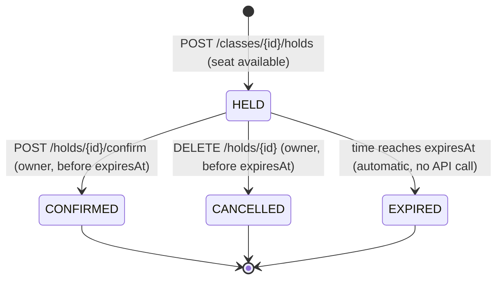

# PRD — School Admission System

| | |
|---|---|
| Context | Take-home assignment, Assistant Software Engineer, Onnorokom Projukti Ltd |
| Deadline | **11 November 2026, 11:59:59 PM** (state of the public GitHub repo at that moment is evaluated) |
| Stack (mandated) | C# .NET 8+ (we use .NET 10), PostgreSQL, React 18+ (we use 19), Docker |
| Status | Source of truth for *what* to build. `API.md` is the source of truth for the HTTP contract. |

---

## 1. Background

A private school runs admission for the new academic year online. Admission is **first come, first served** — no lottery. Every shift of every class has a fixed number of seats (e.g. "Class 6 – Morning Shift" has 120). When admission opens, **thousands of parents apply at the same moment**.

Applying puts a seat **on hold** in the student's name for a limited time. If the admission fee is paid within that time, admission is **confirmed**. If not, the seat is released for others.

We build both the backend and a React UI. The school admin and parents do everything through the UI.

## 2. Goals and non-goals

**Goals**
1. Never oversell seats, under any concurrency.
2. Release unpaid holds automatically and precisely on time.
3. Give parents a simple, honest, always-up-to-date UI with clear errors.
4. Be trivially runnable (`docker compose up`) and verifiable (automated tests, clear docs).

**Non-goals**
Real payments, real authentication, admin roles, editing/deleting classes, notifications, waitlists, multi-school tenancy, refunds/cancelling confirmed admissions, beautiful visual design ("UI need not be beautiful; it must work correctly and be easy to use").

## 3. Users

| Persona | Needs |
|---------|-------|
| **School admin** | Create classes (one per shift) with a seat count; see live seat accounting. |
| **Parent / guardian** | Enter the child's birth registration number, see which classes have seats, apply, pay within the time limit, cancel, see all their applications — even after refreshing or reopening the browser. |
| **Automated evaluator** | Calls the API directly with exact-contract tests and concurrency bursts; runs the UI. Treat it as a first-class user: the contract must be exact. |

## 4. Glossary

| Term | Meaning |
|------|---------|
| **Class** | A bookable unit = one grade **+ one shift**. "Class 6 – Morning Shift" and "Class 6 – Day Shift" are two different classes with separate seat counts. |
| **Student ID** | The student's **17-digit birth registration number** (জন্ম নিবন্ধন নম্বর). Sent as the `X-Student-Id` header. It is the only identity. |
| **Hold / Application** (আবেদন) | A time-limited reservation of one seat for one student in one class. |
| **Active hold** | `status = HELD` **and** current time `< expiresAt`. |
| **Confirm** (ভর্তি নিশ্চিত) | Paying the admission fee (simulated). Turns a HELD hold into CONFIRMED. |
| **Held seats** | Count of active holds in a class. |
| **Confirmed seats** | Count of CONFIRMED holds in a class. |
| **Available seats** | `totalSeats − heldSeats − confirmedSeats` (never negative). |

## 5. Hold lifecycle

Terminal states never change. A student may apply again to the same class after their hold is CANCELLED or EXPIRED (new hold, new ID, back of the line).

## 6. Functional requirements

| ID | Requirement | Endpoint | Screen |
|----|-------------|----------|--------|
| FR-1 | Admin creates a class with a name and a seat count. | `POST /classes` | Create Class (admin) |
| FR-2 | Anyone lists all classes with total, held, confirmed and available seats. | `GET /classes` | Class List |
| FR-3 | Anyone views one class's seat accounting. | `GET /classes/{classId}` | (used by UI where needed) |
| FR-4 | A student applies to a class → seat held until `expiresAt`. 409 if full. | `POST /classes/{classId}/holds` | Class List → "Apply" |
| FR-5 | Anyone views a hold's current status and expiry. | `GET /holds/{holdId}` | Application |
| FR-6 | The owning student pays the fee (simulated) → CONFIRMED. | `POST /holds/{holdId}/confirm` | Application → "Pay Admission Fee" |
| FR-7 | The owning student cancels their HELD application. | `DELETE /holds/{holdId}` | Application → "Cancel" |
| FR-8 | A student lists all their applications with statuses. | `GET /me/holds` | My Applications |
| FR-9 | A box at the top of every page holds the student ID; the UI uses it as identity; it persists across refresh/browser restart. | `X-Student-Id` header | Header bar |
| FR-10 | Holds expire automatically after `HOLD_DURATION_SECONDS`. | background + query-time logic | Application shows EXPIRED live |

## 7. Mandatory rules (from the brief — these are graded)

### Backend
| ID | Rule | Verified by |
|----|------|-------------|
| **R1** | For any class, `held + confirmed` **never exceeds** `totalSeats`, no matter how many requests arrive at once. | Concurrency integration tests (single host + two hosts) |
| **R2** | Hold duration comes from env var `HOLD_DURATION_SECONDS` (default `600`). On expiry the seat returns **by itself** — nobody calls an API. | Expiry tests with `FakeTimeProvider`; manual QA with `HOLD_DURATION_SECONDS=30` |
| **R3** | A student cannot have more than one active application **or** confirmed admission in the same class at the same time. | Integration tests incl. concurrent same-student burst |
| **R4** | Only the student's **own**, **non-expired**, **HELD** application can be confirmed. | Integration tests (403 / 409 cases) |
| **R5** | Confirming the same application multiple times increases `confirmedSeats` **only once**. | Concurrent confirm test |
| **R6** | No data loss on restart, including `docker compose down` then `docker compose up`. | Restart test + manual QA |
| **R7** | Invalid input → **4xx, never 500**. | Robustness test matrix |

### UI
| ID | Rule | Verified by |
|----|------|-------------|
| **R8** | Every task is doable from the UI. No Postman, no direct DB access. | Manual QA script |
| **R9** | When the hold expires, **without a page reload** the application shows `EXPIRED` and the "Pay Admission Fee" button is disabled. | Frontend test with fake timers + manual QA |
| **R10** | Class seat numbers refresh every few seconds **without a page reload**. | Frontend polling test + manual QA |
| **R11** | After refresh, or closing and reopening the browser, the student still sees their ongoing applications. | Manual QA; student ID in `localStorage` + `GET /me/holds` |
| **R12** | Every error (seats full, hold expired, invalid input, server down) is shown in language a parent understands. No blank page, no console-only error. | Frontend error-mapping tests + manual QA |

### Bonus (optional, we do both)
| ID | Bonus |
|----|-------|
| **B1** | Two backend processes on different ports sharing one database still satisfy R1. Explain how in `ASSUMPTIONS.md`. |
| **B2** | Frontend automated tests. |

## 8. Screens

| Screen | Purpose | Key elements |
|--------|---------|--------------|
| Header (every page) | Identity | Student ID input (17 digits, validated, persisted), nav links |
| **Create Class** (admin) | FR-1 | Name, total seats, submit, inline validation, success message |
| **Class List** | FR-2, FR-4 | Table: name, total, held, confirmed, available; "Apply" per row; auto-refresh every 3 s |
| **Application** | FR-5, FR-6, FR-7 | Class, status badge, live countdown, "Pay Admission Fee", "Cancel" |
| **My Applications** | FR-8 | All of this student's applications with status and countdown; link to each |

Details, wireframes and copy: `Design.md`.

## 9. Non-functional requirements

| Area | Requirement |
|------|-------------|
| Concurrency | Correct under thousands of simultaneous apply requests; must also hold with ≥ 2 backend instances. |
| Latency | Seat counts visible in UI within ~3 s of change; hold expiry visible within 1 s of `expiresAt`. |
| Persistence | PostgreSQL on a named Docker volume. |
| Configuration | DB connection string via env var; backend URL for the frontend via env var; `HOLD_DURATION_SECONDS` via env var. |
| Portability | Only Docker required. Backend at `http://localhost:8080`. |
| Robustness | No 500 for client mistakes; DB outage → 503; UI never blank. |
| Observability | Structured console logs; problem+json includes `traceId`. |
| Simplicity | Code a reviewer can read in 20 minutes. |

## 10. Deliverables (graded)

| ID | Deliverable |
|----|-------------|
| D1 | Public GitHub repo with `backend/` and `frontend/` folders and an incremental commit history (no single giant commit). |
| D2 | `backend/Dockerfile`, `frontend/Dockerfile`, root `docker-compose.yml` — `docker compose up` starts PostgreSQL, backend, frontend. |
| D3 | Root `README.md`: how to run with Docker, the frontend URL, how to run tests. |
| D4 | Root `ASSUMPTIONS.md` (short): what was assumed where the brief is silent, and why. Include the B1 explanation. |
| D5 | ≥ 3 backend automated tests, one being a concurrency test (many simultaneous requests → never more holds than seats). |
| D6 | Root `AI_USAGE.md` (short): AI tools used, for which parts, where the AI was wrong and how it was caught. |
| D7 | Submit the repo link via the form in the brief before the deadline. Do **not** publish or commit the assignment PDF. |

## 11. Out of scope

Login/OTP, admin authorization, real payment gateway, fee amounts, emails/SMS, waitlists, class edit/delete, cancelling confirmed admissions, pagination, i18n framework (strings are centralized instead), HTTPS termination.

## 12. Product-level acceptance

The product is done when, from a fresh clone with only Docker installed:
1. `docker compose up --build` brings up all three services; `http://localhost:5173` loads.
2. An admin creates "Class 6 - Morning Shift" with 2 seats in the UI.
3. Three different student IDs apply; the first two get holds, the third sees "No seats left".
4. One student pays → CONFIRMED; the other waits → sees EXPIRED live, Pay disabled; seat counts update by themselves.
5. After `docker compose down && docker compose up`, all of the above is still visible.
6. `docker compose --profile test run --rm backend-tests` and `... frontend-tests` pass.
